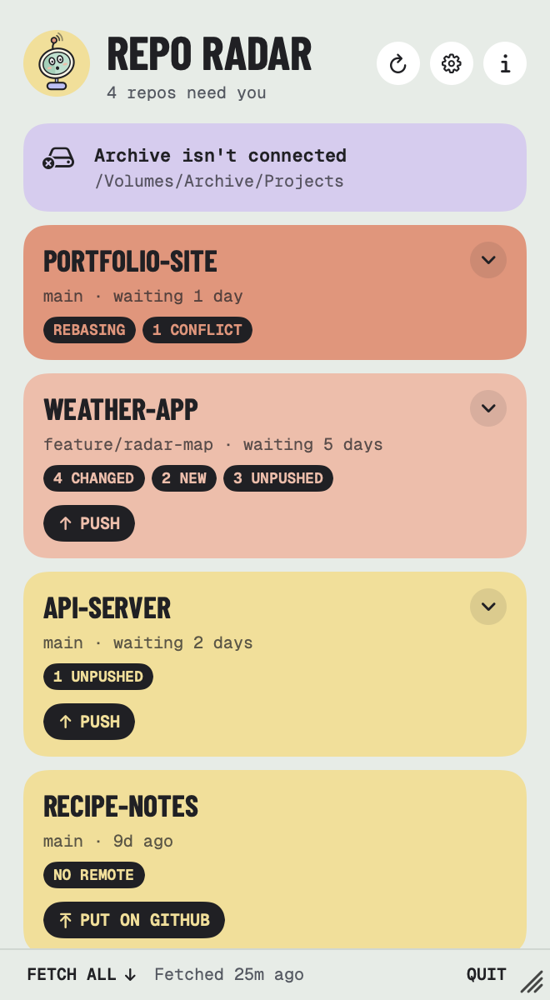
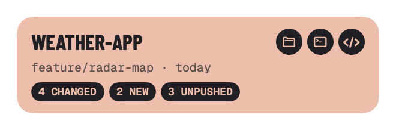
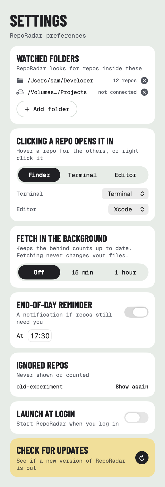

<p align="center">
  
</p>

<h1 align="center">RepoRadar</h1>

<p align="center">
  <strong>Every repo with work you haven't pushed, in your menu bar.</strong><br>
  An open-source Mac menu bar app. Point it at the folder your projects live in and it finds every git repo inside, then shows the ones with changes you haven't committed, commits you haven't pushed, repos with no remote at all, and anything stuck halfway through a merge or rebase.
</p>

<p align="center">
  <a href="https://github.com/RossNicholson/reporadar/releases/latest"></a>
  
  
  
  <a href="LICENSE"></a>
</p>

<p align="center">
  <picture>
    <source media="(prefers-color-scheme: dark)" srcset="docs/panel-dark.png">
    
  </picture>
</p>

<p align="center">
  <a href="#install">Install</a> ·
  <a href="#what-it-flags">What it flags</a> ·
  <a href="#features">Features</a> ·
  <a href="#privacy">Privacy</a> ·
  <a href="#build-from-source">Build</a>
</p>

---

## Install

```bash
brew tap RossNicholson/tap
brew trust --cask rossnicholson/tap/reporadar
brew install --cask reporadar
```

Homebrew 7 asks you to trust casks from other taps before installing them. On older versions of Homebrew, skip the `brew trust` line.

**Requirements:** macOS 14 Sonoma or later, and git: Homebrew's, or Apple's from the Command Line Tools (RepoRadar offers to install them if neither is there).

## What it flags

The menu bar shows how many repos need you. Those are the ones with work that isn't safe on a remote yet:

| Tag | Means |
|---|---|
| **Merging / Rebasing / Cherry-picking** | git is partway through something. Finish it or abort it. |
| **Conflicts** | files with merge conflicts |
| **Changed** | tracked files with changes, staged or not |
| **New** | files and folders git isn't tracking yet |
| **Unpushed** | commits on *any* local branch that aren't on any remote, so a forgotten feature branch counts too |
| **No remote** | a repo with commits but nowhere to push them: nothing in it is backed up |

Under **Worth a look**, without counting in the menu bar: **Behind** (commits on the remote you haven't pulled, as of the last fetch), **Upstream gone** (the branch was deleted on the remote, often after a merged pull request) and **Stashes**. Repos that are committed and pushed fold away under **All clear**.

## Features

<p align="center">
  
</p>

- **Finds your repos.** Watch one folder or several. It skips `node_modules`, Unity's `Library`, `DerivedData`, build folders and the like, and doesn't count a repo inside another one.
- **Live.** It watches the folders, so the list updates as you work, commit and push. A watched drive that's unplugged shows as *not connected* until it's back.
- **Open from the list.** Click a repo to open it in Finder, your terminal or your editor (you choose which). Hover for quick buttons, or right-click for Open on GitHub, Copy Path, Snooze and Ignore.
- **Fetch.** **Fetch all** in the footer, or in the background every 15 minutes or hour, so the behind counts are right. Fetching never changes your files or branches.
- **End-of-day reminder.** A notification at a time you pick if repos still have loose ends.
- **Snooze or ignore.** Snooze a repo for a day or a week, or ignore it for good (Settings lists ignored repos so you can bring them back).

RepoRadar only reads. It never commits, pushes, pulls or changes a repo: `git fetch` is the only command it runs that talks to a remote, and that only updates remote-tracking branches.

<p align="center">
  
</p>

## Privacy

RepoRadar has no accounts and no analytics. It runs git on your Mac and keeps its settings in its own preferences. The only network traffic is `git fetch` to your own remotes (when you fetch, or in the background if you turn that on), using your existing git sign-in, and **Check for updates** in Settings, only when you press it (through Homebrew, or GitHub if you downloaded the app directly).

## Build from source

```bash
brew install xcodegen
git clone https://github.com/RossNicholson/reporadar.git
cd reporadar
make test        # unit tests, including real git against throwaway repos
make build       # unsigned debug build
```

`make run` builds a signed debug copy and opens it (it signs with Ross's Developer ID; change `DEVELOPMENT_TEAM` in the Makefile for yours). Launch with `-demo YES` for sample repos. `make screenshots` renders the panel with demo data into `build/screenshots`.

The look comes from [HouseStyle](https://github.com/RossNicholson/mac-house-style), shared with Ross's other Mac apps: [BrewDock](https://github.com/RossNicholson/brewdock), [ClawdBar](https://github.com/RossNicholson/clawdbar), [Mop Up](https://github.com/RossNicholson/mop-up) and [KeyBar](https://github.com/RossNicholson/keybar).

## Licence

MIT. See [LICENSE](LICENSE).
